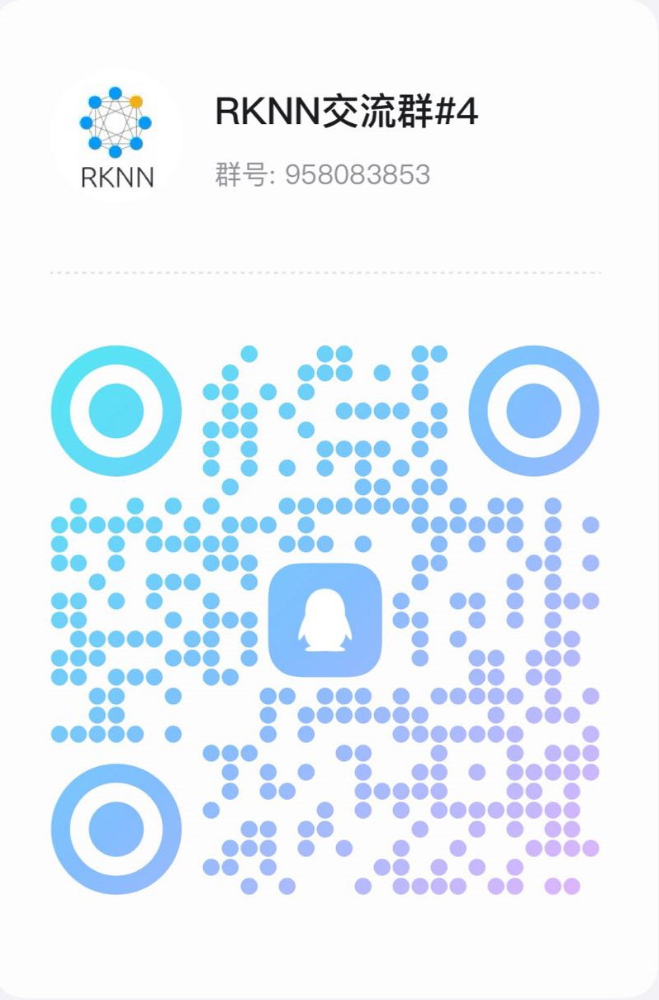
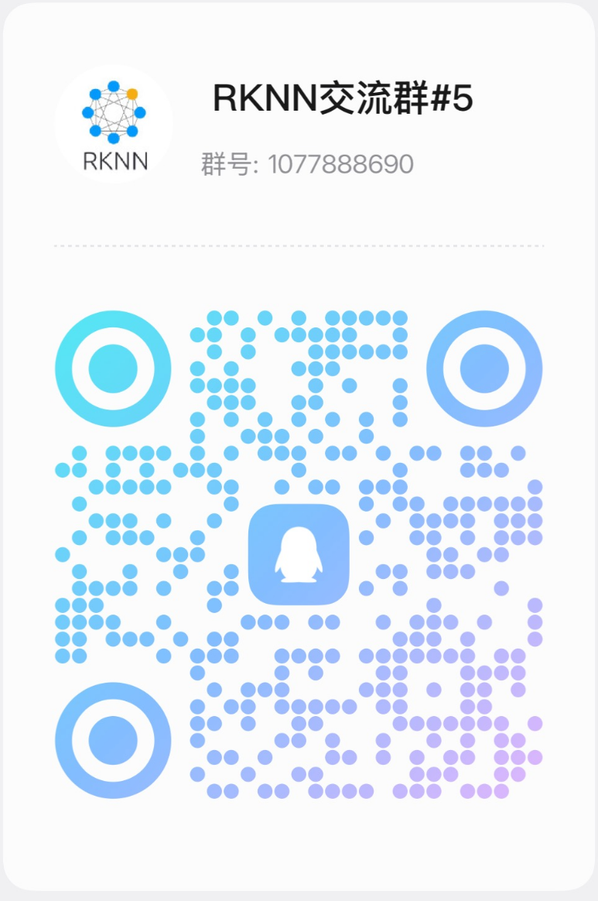

[中文](README_CN.md)

# Introduction

RKNN3 SDK provides the complete software stack for deploying AI models on RK1820/RK1828/RK3572, including:

**Core Components**:

- **[RKNN3-Toolkit](https://github.com/airockchip/rknn3-toolkit)**: PC-side software development kit for model conversion, inference, performance evaluation, etc.
- **[RKNN3 Runtime](https://github.com/airockchip/rknn3-toolkit/tree/main/rknn3-runtime)**: On-board runtime library providing C/C++ programming interfaces for deploying RKNN models and accelerating AI applications.
- **[RKNN3-Toolkit Lite](https://github.com/airockchip/rknn3-toolkit/tree/main/rknn3-toolkit-lite)**: On-board Python inference interface that wraps the RKNN3 Runtime (C API), supporting rapid verification and upper-layer application development for CNN / LLM / VLM models.
- **[rkllm3-server](https://github.com/airockchip/rknn3-toolkit/tree/main/rknn3-runtime/rkllm3-server)**: On-board OpenAI-compatible API service supporting text, image, and audio inputs, suitable for service deployment of LLM / VLM models.

**Companion Resources**:

- **[RKNN3 Model Zoo](https://github.com/airockchip/rknn3-model-zoo)**: Model conversion and deployment example repository, including reference implementations for CNN / LLM / VLM and other models.
- **[RK1820/RK1828 Firmware](https://console.box.lenovo.com/l/PHk0PF)**: Prebuilt firmware for RK1820/RK1828 development boards; flash it to deploy and run RKNN3 models on the board.
- **[RKNN3 MCP](doc/EN/09_RKNN3_MCP_QuickStart_V0.1.0.pdf)**: RKNN3 MCP is a model deployment assistant for the Rockchip RKNN3 platform. Through AI development tools that support MCP, users can describe their requirements in natural language, and the Agent — guided by RKNN3 MCP — helps complete model analysis, ONNX export, RKNN3 model conversion, accuracy analysis, and on-board deployment. RKNN3 MCP covers CNN, ViT, LLM, VLM, ASR, and other model workflows, and supports LoRA conversion and deployment as well as multi-NPU deployment and inference.

**Typical Workflow**: The typical model deployment workflow consists of the following three stages:

1. **Model Conversion (PC side)**: Use RKNN3-Toolkit to convert trained models (e.g., ONNX) to RKNN format, configure normalization, quantization, and target platform parameters, and export `.rknn` and `.weight` model files.
2. **Model Evaluation (board-connected)**: Connect to the development board via USB or network to verify inference correctness, and perform accuracy and performance analysis.
3. **Board Deployment (on-board)**: Load and run the RKNN model in the application using the RKNN3 Runtime C API, completing business integration and accelerated inference.

# Supported Platforms

- RK1820
- RK1828
- RK3572

**Deployment Modes**:

- **Coprocessor mode (RK1820/RK1828)**: Requires a host SoC (e.g., RK3588 / RK3576) or Windows PC; communicates with the coprocessor via `rknn3_transfer_proxy` over PCIe / USB / Ethernet.
- **Non-coprocessor mode (RK3572)**: The NPU is integrated inside the SoC; models run directly on the board.

**Supported OS**: Android / Linux / Windows / macOS

**Note**:

- **For RK3588/RK3576/RK3568/RK3566/RK3562 series, RV1103/RV1106, RV1103B/RV1106B, RV1126B, RK2118, please refer to:**

  https://github.com/airockchip/rknn-toolkit2

- **For RK1808/RV1109/RV1126/RK3399Pro, please refer to:**

  https://github.com/airockchip/rknn-toolkit

  https://github.com/airockchip/rknpu

  https://github.com/airockchip/RK3399Pro_npu

- **RKNN3 Model Zoo provides more conversion and deployment examples**

  https://github.com/airockchip/rknn3-model-zoo

# Supported Models

### LLM

 - [x] [Qwen2.5](https://huggingface.co/collections/Qwen/qwen25)
 - [x] [Qwen3](https://huggingface.co/collections/Qwen/qwen3)
 - [x] [Qwen3.5](https://huggingface.co/collections/Qwen/qwen35)
 - [x] [Youtu-LLM](https://huggingface.co/tencent/Youtu-LLM-2B)
 - [x] [GLM-Edge](https://modelscope.cn/models/ZhipuAI/glm-edge-1.5b-chat)
 - [x] [MiniCPM5](https://huggingface.co/collections/openbmb/minicpm5)
 - [x] [Nanbeige4.2](https://huggingface.co/Nanbeige/Nanbeige4.2-3B)
 - [x] [FunctionGemma](https://huggingface.co/google/functiongemma-270m-it)
 - [x] [LFM2.5](https://huggingface.co/LiquidAI/LFM2.5-1.2B-Instruct)
 - [x] [Qwen3-30B-A3B](https://huggingface.co/Qwen/Qwen3-30B-A3B)
 - [x] [Qwen3.5-35B-A3B](https://huggingface.co/Qwen/Qwen3.5-35B-A3B)
 - [x] [GPT-OSS-20B-A3.6B](https://huggingface.co/openai/gpt-oss-20b)
 - [x] [Spark-X2.5](https://huggingface.co/collections/XHToken/spark-x25)

### VLM

 - [x] [Qwen2.5-VL](https://huggingface.co/collections/Qwen/qwen25-vl)
 - [x] [Qwen3-VL](https://huggingface.co/collections/Qwen/qwen3-vl)
 - [x] [Qwen3.5-VL](https://huggingface.co/collections/Qwen/qwen35)
 - [x] [FastVLM](https://github.com/apple/ml-fastvlm)
 - [x] [InternVL3](https://huggingface.co/OpenGVLab/InternVL3-2B)
 - [x] [InternVL3.5](https://huggingface.co/OpenGVLab/InternVL3_5-4B-Instruct)
 - [x] [MiMo-VL-RL](https://huggingface.co/XiaomiMiMo/MiMo-VL-7B-RL)
 - [x] [Janus-Pro](https://huggingface.co/deepseek-ai/Janus-Pro-1B)
 - [x] [MiniCPM-V-4](https://huggingface.co/openbmb/MiniCPM-V-4)
 - [x] [SmolVLM](https://huggingface.co/HuggingFaceTB/SmolVLM-500M-Instruct)
 - [x] [SmolVLM2](https://huggingface.co/HuggingFaceTB/SmolVLM2-500M-Video-Instruct)
 - [x] [UI_TARS](https://huggingface.co/ByteDance-Seed/UI-TARS-2B-SFT)
 - [x] [gme-Qwen2-VL](https://huggingface.co/Alibaba-NLP/gme-Qwen2-VL-2B-Instruct)
 - [x] [LocateAnything](https://huggingface.co/nvidia/LocateAnything-3B)
 - [x] [MiniCPM-V-4.7-1B](https://huggingface.co/openbmb/MiniCPM-V-4.7-1B)
 - [x] [MiniCPM-V-4.7-35B-A3B](https://huggingface.co/openbmb/MiniCPM-V-4.7-35B-A3B)
 - [x] [Mage-VL](https://huggingface.co/microsoft/Mage-VL)

### Omni

 - [x] [Qwen2.5-Omni (Thinker)](https://huggingface.co/collections/Qwen/qwen25-omni)
 - [x] Qwen3-Omni
 - [x] Qwen3.5-Omni
 - [x] [Gemma4](https://huggingface.co/google/gemma-4-E2B-it)

### ASR (Speech Recognition)

 - [x] [Qwen3-ASR](https://huggingface.co/collections/Qwen/qwen3-asr)
 - [x] [WeNet (Conformer)](https://github.com/wenet-e2e/wenet)
 - [x] [Whisper](https://huggingface.co/openai/whisper-large-v3)
 - [x] [SenseVoice](https://modelscope.cn/models/iic/SenseVoiceSmall)
 - [x] [Zipformer](https://huggingface.co/pfluo/k2fsa-zipformer-chinese-english-mixed)
 - [x] [Audio8-ASR-0.1B](https://huggingface.co/Edge0/Audio8-ASR-0.1B)
 - [x] [Qwen3-ForcedAligner-0.6B](https://huggingface.co/Qwen/Qwen3-ForcedAligner-0.6B)
 - [x] [pyannote speaker-diarization-community-1](https://huggingface.co/pyannote/speaker-diarization-community-1)

### TTS (Text-to-Speech)

 - [x] [Qwen3_TTS](https://huggingface.co/collections/Qwen/qwen3-tts)
 - [x] [VITS](https://github.com/jaywalnut310/vits)

### Embedding / Reranker

 - [x] [Qwen3-Embedding](https://huggingface.co/collections/Qwen/qwen3-embedding)
 - [x] [Qwen3-Reranker](https://huggingface.co/collections/Qwen/qwen3-reranker)
 - [x] [F2LLM-v2](https://huggingface.co/codefuse-ai/F2LLM-v2-4B)
 - [x] [WeMM-Embedding-2B](https://huggingface.co/tencent/WeMM-Embedding-2B)

### Translation

 - [x] [HY-MT1.5](https://huggingface.co/tencent/HY-MT1.5-1.8B)

### Text Classification / Safety

 - [x] [openai/privacy-filter](https://huggingface.co/openai/privacy-filter)

### Decision Model

 - [x] [Intern-Decision-0.8B](https://huggingface.co/internlm/Intern-Decision-0.8B)
 - [x] [convaiinnovations/laya](https://huggingface.co/convaiinnovations/laya)

### OCR

 - [x] [PaddleOCR VL](https://huggingface.co/PaddlePaddle/PaddleOCR-VL)
 - [x] [Unlimited-OCR](https://huggingface.co/baidu/Unlimited-OCR)
 - [x] [dots.ocr](https://huggingface.co/dots-studio/dots.ocr)
 - [x] [dots.mocr](https://huggingface.co/dots-studio/dots.mocr)

### CV (Computer Vision)

 - [x] [SigLIP](https://huggingface.co/google/siglip-so400m-patch14-384)
 - [x] [SigLIP2](https://huggingface.co/google/siglip2-so400m-patch14-384)
 - [x] [MetaCLIP2](https://huggingface.co/facebook/metaclip-2-worldwide-m16-384)
 - [x] [QA-CLIP](https://github.com/TencentARC-QQ/QA-CLIP)
 - [x] [DINOv2](https://huggingface.co/facebook/dinov2-base)
 - [x] [DINOv3](https://huggingface.co/facebook/dinov3-vits16-pretrain-lvd1689m)
 - [x] [Depth-Anything-V2-small](https://huggingface.co/depth-anything/Depth-Anything-V2-Small)
 - [x] [Depth-Anything-V3](https://huggingface.co/depth-anything/DA3-BASE)
 - [x] [Diffusion Policy](https://github.com/real-stanford/diffusion_policy)
 - [x] [MiniCPM-RobotManip](https://huggingface.co/openbmb/MiniCPM-RobotManip)
 - [x] MobileNetV1 / V2
 - [x] [ResNet-50](https://huggingface.co/microsoft/resnet-50)
 - [x] [YOLOv5](https://github.com/ultralytics/yolov5) / [YOLOv6](https://github.com/meituan/YOLOv6) / [YOLOv8](https://github.com/ultralytics/ultralytics)
 - [x] [YOLO-World](https://github.com/AILab-CVC/YOLO-World)
 - [x] [YOLO26](https://github.com/ultralytics/assets/releases/download/v8.4.0/yolo26s.pt) / [YOLO26-Segment](https://github.com/ultralytics/assets/releases/download/v8.4.0/yolo26s-seg.pt) / [YOLO26-Pose](https://github.com/ultralytics/assets/releases/download/v8.4.0/yolo26s-pose.pt)

### VLA

 - [x] [GR00T-N1.7-3B](https://huggingface.co/nvidia/GR00T-N1.7-3B)
 - [x] [Physical-Intelligence/openpi](https://github.com/Physical-Intelligence/openpi)

# Performance

For performance data, please refer to the [Release Notes](doc/EN/00_RKNN3_SDK_Release_Notes_V1.2.0.pdf).

# Supported Python Versions:

- Python 3.10
- Python 3.12

# Changelog

## V1.2.0
- Added the RKNN3 MCP model deployment assistant (Beta)
- Added MoE (Mixture of Experts) support
- Added PagedAttention support
- Added support for exporting multiple separate LoRA weights
- Added Grammar-constrained output support for LLMs
- Added support for loading models from the coprocessor's eMMC
- Added MatMul APIs for RK3572
- Added Linux x86_64 coprocessor mode and macOS arm64 platform support
- Added model custom information query support
- Added W4BF16 exMatMul support
- Added operators including Log, ReduceLogSumExp, Tan, Atan, CumSum, and LSTM/GRU
- Added Ethernet support on Windows (RK182X coprocessor mode)
- Improved LUT activation and exponential computation precision
- Improved Windows USB communication efficiency
- Improved LLM support on RK3572
- Fixed a memory leak issue on RK3572 in certain scenarios
- Fixed issues with Resize, AveragePool, Sub, Transpose, and TopK operators under certain configurations
- Fixed RK182X Ethernet connection stability issues

For more information about previous releases, please refer to [CHANGELOG.md](CHANGELOG.md).

# Documentation

Detailed documentation is available in the `doc/` directory:

- [RKNN3 SDK Release Notes](doc/EN/00_RKNN3_SDK_Release_Notes_V1.2.0.pdf)
- [RKNN3 SDK Quick Start](doc/EN/01_RKNN3_SDK_QuickStart_V1.2.0.pdf)
- [RKNN3 SDK Development Guide](doc/EN/02_RKNN3_SDK_Development_Guide_V1.2.0.pdf)
- [RKNN3 Toolkit Python API Reference](doc/EN/03_RKNN3_Toolkit_Python_API_Reference_V1.2.0.pdf)
- [RKNN3 Toolkit Lite Python API Reference](doc/EN/04_RKNN3_Toolkit_Lite_Python_API_Reference_V1.2.0.pdf)
- [RKNN3 Runtime C API Reference](doc/EN/05_RKNN3_Runtime_C_API_Reference_V1.2.0.pdf)
- [RKLLM3 Server User Guide](doc/EN/06_RKLLM3_Server_User_Guide_V1.2.0.pdf)
- [RKNN3 Supported Operators and Constraints Reference](doc/EN/07_RKNN3_Supported_Operators_and_Constraints_Reference_V1.2.0.pdf)
- [RKNN3 MoE ONNX Export And Conversion Guide](doc/EN/08_RKNN3_MoE_ONNX_Export_And_Conversion_Guide_V1.2.0.pdf)
- [RKNN3 MCP Quick Start](doc/EN/09_RKNN3_MCP_QuickStart_V0.1.0.pdf)

# Cloud Drive Resources

- RK3588 EVB10 prebuilt firmware (RK3588_EVB10/RELEASE_V1.2.0):

   [https://console.box.lenovo.com/l/7oOghG](https://console.box.lenovo.com/l/7oOghG)

- RK1820/RK1828 prebuilt firmware (RK1820_RK1828/RELEASE_V1.2.0):

    [https://console.box.lenovo.com/l/PHk0PF](https://console.box.lenovo.com/l/PHk0PF)

- Pre-converted RKNN models (RKNN3_SDK/rknn3_models/v1.2.0):

    [https://console.box.lenovo.com/l/H1fig1](https://console.box.lenovo.com/l/H1fig1), access code: `rknn`

# Notes

- **RKNN3-Toolkit** is **not compatible** with [RKNN-Toolkit](https://github.com/airockchip/rknn-toolkit) and [RKNN-Toolkit2](https://github.com/airockchip/rknn-toolkit2).

# Feedback and Community Support

- [Redmine](https://redmine.rock-chips.com) (**Recommended for reporting issues. Please contact sales or an FAE to get a Redmine account**)
- QQ Group 1: 1025468710 (Full, please join group 5)
- QQ Group 2: 547021958 (Full, please join group 5)
- QQ Group 3: 469385426 (Full, please join group 5)
- QQ Group 4: 958083853 (Full, please join group 5)
- QQ Group 5: 1077888690

  
  
  
  
  

