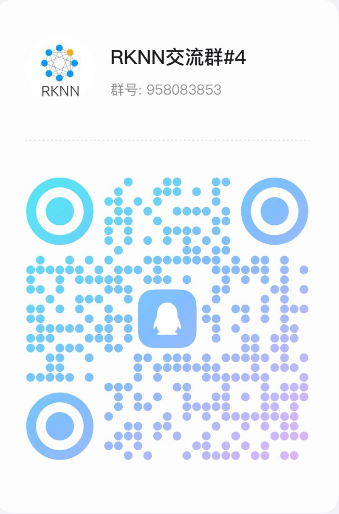
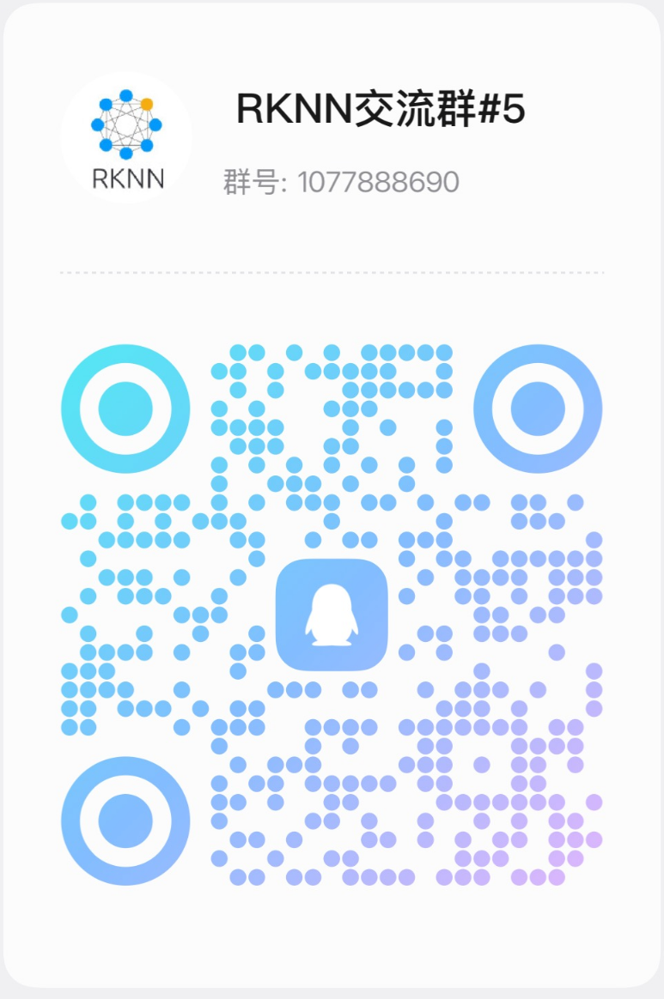

[English](README.md)

# 简介

RKNN3 SDK 提供了将 AI 模型部署到 RK1820/RK1828/RK3572 所需的完整软件栈，包括：

**核心组件**：

- **[RKNN3-Toolkit](https://github.com/airockchip/rknn3-toolkit)**：PC 端软件开发套件，支持模型转换、推理和性能评估等。
- **[RKNN3 Runtime](https://github.com/airockchip/rknn3-toolkit/tree/main/rknn3-runtime)**：板端运行时库，提供 C/C++ 编程接口，用于部署 RKNN 模型并加速 AI 应用。
- **[RKNN3-Toolkit Lite](https://github.com/airockchip/rknn3-toolkit/tree/main/rknn3-toolkit-lite)**：板端 Python 推理接口，对 RKNN3 Runtime（C API）进行 Python 封装，支持 CNN / LLM / VLM 模型的快速验证与上层应用开发。
- **[rkllm3-server](https://github.com/airockchip/rknn3-toolkit/tree/main/rknn3-runtime/rkllm3-server)**：板端 OpenAI 兼容 API 服务，支持文本、图片和语音输入，适用于 LLM / VLM 模型的服务化部署。

**配套资源**：

- **[RKNN3 Model Zoo](https://github.com/airockchip/rknn3-model-zoo)**：模型转换与部署示例仓库，包含 CNN / LLM / VLM 等多种模型的参考实现。
- **[RK1820/RK1828 固件](https://console.box.lenovo.com/l/PHk0PF)**：RK1820/RK1828 开发板预编译固件，烧录后即可在板端部署运行 RKNN3 模型。
- **[RKNN3 MCP](doc/CN/09_RKNN3_MCP_快速入门_V0.1.0.pdf)**：RKNN3 MCP 是面向瑞芯微 RKNN3 平台的模型部署助手。用户可以通过支持 MCP 的 AI 开发工具，以自然语言描述需求，由 Agent 在 RKNN3 MCP 的指导下，协助完成模型分析、ONNX 导出、RKNN3 模型转换、精度分析和板端部署等任务。RKNN3 MCP 覆盖 CNN、ViT、LLM、VLM、ASR 等模型工作流，并支持 LoRA 转换与部署、多卡部署与推理等功能。

**典型工作流程**：典型的模型部署流程分为以下三个阶段：

1. **模型转换（PC 侧）**：使用 RKNN3-Toolkit 将训练好的模型（如 ONNX）转换为 RKNN 格式，配置归一化、量化与目标平台等参数，导出 `.rknn` 与 `.weight` 模型文件。
2. **模型评估（连板）**：通过 USB 或网络连接开发板，验证模型推理的功能正确性，并进行精度与性能分析。
3. **板端部署运行**：在应用中使用 RKNN3 Runtime C API 加载并运行 RKNN 模型，完成业务集成与推理加速。

# 支持平台

  - RK1820
  - RK1828
  - RK3572

**部署模式**：

- **协处理器模式（RK1820/RK1828）**：需搭配主控 SoC（如 RK3588 / RK3576）或 Windows PC，通过 `rknn3_transfer_proxy` 经 PCIe / USB / Ethernet 与协处理器通信。
- **非协处理器模式（RK3572）**：NPU 集成在 SoC 内部，模型直接在本机运行。

**支持系统**：Android / Linux / Windows / macOS

**注意**：

- **对于 RK3588/RK3576/RK3568/RK3566/RK3562 系列、RV1103/RV1106、RV1103B/RV1106B、RV1126B、RK2118，请参考：**

    https://github.com/airockchip/rknn-toolkit2      
    
- **对于 RK1808/RV1109/RV1126/RK3399Pro，请参考：** 

    https://github.com/airockchip/rknn-toolkit  
    
    https://github.com/airockchip/rknpu 

    https://github.com/airockchip/RK3399Pro_npu  

- **RKNN3 Model Zoo 提供了更多的转换及部署示例**

   https://github.com/airockchip/rknn3-model-zoo

# 支持模型

### LLM

 - [x] [Qwen2.5](https://huggingface.co/collections/Qwen/qwen25)
 - [x] [Qwen3](https://huggingface.co/collections/Qwen/qwen3)
 - [x] [Qwen3.5](https://huggingface.co/collections/Qwen/qwen35)
 - [x] [Youtu-LLM](https://huggingface.co/tencent/Youtu-LLM-2B)
 - [x] [GLM-Edge](https://modelscope.cn/models/ZhipuAI/glm-edge-1.5b-chat)
 - [x] [MiniCPM5](https://huggingface.co/collections/openbmb/minicpm5)
 - [x] [Nanbeige4.2](https://huggingface.co/Nanbeige/Nanbeige4.2-3B)
 - [x] [FunctionGemma](https://huggingface.co/google/functiongemma-270m-it)
 - [x] [LFM2.5](https://huggingface.co/LiquidAI/LFM2.5-1.2B-Instruct)
 - [x] [Qwen3-30B-A3B](https://huggingface.co/Qwen/Qwen3-30B-A3B)
 - [x] [Qwen3.5-35B-A3B](https://huggingface.co/Qwen/Qwen3.5-35B-A3B)
 - [x] [GPT-OSS-20B-A3.6B](https://huggingface.co/openai/gpt-oss-20b)
 - [x] [Spark-X2.5](https://huggingface.co/collections/XHToken/spark-x25)

### VLM

 - [x] [Qwen2.5-VL](https://huggingface.co/collections/Qwen/qwen25-vl)
 - [x] [Qwen3-VL](https://huggingface.co/collections/Qwen/qwen3-vl)
 - [x] [Qwen3.5-VL](https://huggingface.co/collections/Qwen/qwen35)
 - [x] [FastVLM](https://github.com/apple/ml-fastvlm)
 - [x] [InternVL3](https://huggingface.co/OpenGVLab/InternVL3-2B)
 - [x] [InternVL3.5](https://huggingface.co/OpenGVLab/InternVL3_5-4B-Instruct)
 - [x] [MiMo-VL-RL](https://huggingface.co/XiaomiMiMo/MiMo-VL-7B-RL)
 - [x] [Janus-Pro](https://huggingface.co/deepseek-ai/Janus-Pro-1B)
 - [x] [MiniCPM-V-4](https://huggingface.co/openbmb/MiniCPM-V-4)
 - [x] [SmolVLM](https://huggingface.co/HuggingFaceTB/SmolVLM-500M-Instruct)
 - [x] [SmolVLM2](https://huggingface.co/HuggingFaceTB/SmolVLM2-500M-Video-Instruct)
 - [x] [UI_TARS](https://huggingface.co/ByteDance-Seed/UI-TARS-2B-SFT)
 - [x] [gme-Qwen2-VL](https://huggingface.co/Alibaba-NLP/gme-Qwen2-VL-2B-Instruct)
 - [x] [LocateAnything](https://huggingface.co/nvidia/LocateAnything-3B)
 - [x] [MiniCPM-V-4.7-1B](https://huggingface.co/openbmb/MiniCPM-V-4.7-1B)
 - [x] [MiniCPM-V-4.7-35B-A3B](https://huggingface.co/openbmb/MiniCPM-V-4.7-35B-A3B)
 - [x] [Mage-VL](https://huggingface.co/microsoft/Mage-VL)

### Omni

 - [x] [Qwen2.5-Omni (Thinker)](https://huggingface.co/collections/Qwen/qwen25-omni)
 - [x] Qwen3-Omni
 - [x] Qwen3.5-Omni
 - [x] [Gemma4](https://huggingface.co/google/gemma-4-E2B-it)

### ASR（语音识别）

 - [x] [Qwen3-ASR](https://huggingface.co/collections/Qwen/qwen3-asr)
 - [x] [WeNet (Conformer)](https://github.com/wenet-e2e/wenet)
 - [x] [Whisper](https://huggingface.co/openai/whisper-large-v3)
 - [x] [SenseVoice](https://modelscope.cn/models/iic/SenseVoiceSmall)
 - [x] [Zipformer](https://huggingface.co/pfluo/k2fsa-zipformer-chinese-english-mixed)
 - [x] [Audio8-ASR-0.1B](https://huggingface.co/Edge0/Audio8-ASR-0.1B)
 - [x] [Qwen3-ForcedAligner-0.6B](https://huggingface.co/Qwen/Qwen3-ForcedAligner-0.6B)
 - [x] [pyannote speaker-diarization-community-1](https://huggingface.co/pyannote/speaker-diarization-community-1)

### TTS（文本转语音）

 - [x] [Qwen3_TTS](https://huggingface.co/collections/Qwen/qwen3-tts)
 - [x] [VITS](https://github.com/jaywalnut310/vits)

### Embedding / Reranker

 - [x] [Qwen3-Embedding](https://huggingface.co/collections/Qwen/qwen3-embedding)
 - [x] [Qwen3-Reranker](https://huggingface.co/collections/Qwen/qwen3-reranker)
 - [x] [F2LLM-v2](https://huggingface.co/codefuse-ai/F2LLM-v2-4B)
 - [x] [WeMM-Embedding-2B](https://huggingface.co/tencent/WeMM-Embedding-2B)

### 翻译

 - [x] [HY-MT1.5](https://huggingface.co/tencent/HY-MT1.5-1.8B)

### 文本分类 / 安全

 - [x] [openai/privacy-filter](https://huggingface.co/openai/privacy-filter)

### 决策模型

 - [x] [Intern-Decision-0.8B](https://huggingface.co/internlm/Intern-Decision-0.8B)
 - [x] [convaiinnovations/laya](https://huggingface.co/convaiinnovations/laya)

### OCR

 - [x] [PaddleOCR VL](https://huggingface.co/PaddlePaddle/PaddleOCR-VL)
 - [x] [Unlimited-OCR](https://huggingface.co/baidu/Unlimited-OCR)
 - [x] [dots.ocr](https://huggingface.co/dots-studio/dots.ocr)
 - [x] [dots.mocr](https://huggingface.co/dots-studio/dots.mocr)

### CV（计算机视觉）

 - [x] [SigLIP](https://huggingface.co/google/siglip-so400m-patch14-384)
 - [x] [SigLIP2](https://huggingface.co/google/siglip2-so400m-patch14-384)
 - [x] [MetaCLIP2](https://huggingface.co/facebook/metaclip-2-worldwide-m16-384)
 - [x] [QA-CLIP](https://github.com/TencentARC-QQ/QA-CLIP)
 - [x] [DINOv2](https://huggingface.co/facebook/dinov2-base)
 - [x] [DINOv3](https://huggingface.co/facebook/dinov3-vits16-pretrain-lvd1689m)
 - [x] [Depth-Anything-V2-small](https://huggingface.co/depth-anything/Depth-Anything-V2-Small)
 - [x] [Depth-Anything-V3](https://huggingface.co/depth-anything/DA3-BASE)
 - [x] [Diffusion Policy](https://github.com/real-stanford/diffusion_policy)
 - [x] [MiniCPM-RobotManip](https://huggingface.co/openbmb/MiniCPM-RobotManip)
 - [x] MobileNetV1 / V2
 - [x] [ResNet-50](https://huggingface.co/microsoft/resnet-50)
 - [x] [YOLOv5](https://github.com/ultralytics/yolov5) / [YOLOv6](https://github.com/meituan/YOLOv6) / [YOLOv8](https://github.com/ultralytics/ultralytics)
 - [x] [YOLO-World](https://github.com/AILab-CVC/YOLO-World)
 - [x] [YOLO26](https://github.com/ultralytics/assets/releases/download/v8.4.0/yolo26s.pt) / [YOLO26-Segment](https://github.com/ultralytics/assets/releases/download/v8.4.0/yolo26s-seg.pt) / [YOLO26-Pose](https://github.com/ultralytics/assets/releases/download/v8.4.0/yolo26s-pose.pt)

### VLA

 - [x] [GR00T-N1.7-3B](https://huggingface.co/nvidia/GR00T-N1.7-3B)
 - [x] [Physical-Intelligence/openpi](https://github.com/Physical-Intelligence/openpi)

# 性能

性能数据请参考 [发布说明](doc/CN/00_RKNN3_SDK_发布说明_V1.2.0.pdf)

# 支持的Python版本：  

  - Python 3.10  
  - Python 3.12  

# 更新日志

## V1.2.0

- 新增 RKNN3 MCP 模型部署助手（Beta）
- 新增 MoE 支持
- 新增 PagedAttention（分页注意力）支持
- 新增多 LoRA 权重分离导出支持
- 新增 LLM Grammar（语法约束）输出支持
- 新增从协处理器 eMMC 加载模型支持
- 新增 MatMul 独立调用接口（仅 RK3572）
- 新增 Linux x86_64 协处理器模式、macOS arm64 平台支持
- 新增模型自定义信息查询支持
- 新增 W4BF16 exMatMul支持
- 新增 Log、ReduceLogSumExp、Tan、Atan、CumSum、LSTM / GRU 等算子支持
- 新增 Windows 平台以太网支持（RK182X 协处理器模式）
- 优化 LUT 激活及指数计算精度
- 优化 Windows USB 通信效率
- 优化 RK3572 大模型支持
- 修复 RK3572 部分场景存在内存泄漏问题
- 修复 Resize、AveragePool、Sub、Transpose、TopK等算子在部分规格异常问题
- 修复 RK182X 以太网连接稳定性问题

更多历史版本的更新内容，请参阅：[CHANGELOG.md](CHANGELOG.md)

# 文档

详细文档位于 `doc/` 目录，包括：

- [RKNN3 SDK 发布说明](doc/CN/00_RKNN3_SDK_发布说明_V1.2.0.pdf)
- [RKNN3 SDK 快速入门](doc/CN/01_RKNN3_SDK_快速入门_V1.2.0.pdf)
- [RKNN3 SDK 开发指南](doc/CN/02_RKNN3_SDK_开发指南_V1.2.0.pdf)
- [RKNN3 Toolkit Python API 参考](doc/CN/03_RKNN3_Toolkit_Python_API_参考_V1.2.0.pdf)
- [RKNN3 Toolkit Lite Python API 参考](doc/CN/04_RKNN3_Toolkit_Lite_Python_API_参考_V1.2.0.pdf)
- [RKNN3 Runtime C API 参考](doc/CN/05_RKNN3_Runtime_C_API_参考_V1.2.0.pdf)
- [RKLLM3 Server 使用指南](doc/CN/06_RKLLM3_Server_使用指南_V1.2.0.pdf)
- [RKNN3 算子支持与约束参考](doc/CN/07_RKNN3_算子支持与约束参考_V1.2.0.pdf)
- [RKNN3 MoE 结构导出适配说明](doc/CN/08_RKNN3_moe结构导出适配说明_V1.2.0.pdf)
- [RKNN3 MCP 快速入门](doc/CN/09_RKNN3_MCP_快速入门_V0.1.0.pdf)

# 网盘资源

- RK3588 EVB10 预编译固件（RK3588_EVB10/RELEASE_V1.2.0）：

   [https://console.box.lenovo.com/l/7oOghG](https://console.box.lenovo.com/l/7oOghG)

- RK1820/RK1828 预编译固件（RK1820_RK1828/RELEASE_V1.2.0）：

    [https://console.box.lenovo.com/l/PHk0PF](https://console.box.lenovo.com/l/PHk0PF)

- 预转换 RKNN 模型（RKNN3_SDK/rknn3_models/v1.2.0）：

    [https://console.box.lenovo.com/l/H1fig1](https://console.box.lenovo.com/l/H1fig1) ，提取码：rknn

# 注意事项  

- **RKNN3-Toolkit** 与 [RKNN-Toolkit](https://github.com/airockchip/rknn-toolkit) 和 [RKNN-Toolkit2](https://github.com/airockchip/rknn-toolkit2) **不兼容**。  

# 反馈与社区支持  

- [Redmine](https://redmine.rock-chips.com) (**推荐反馈问题，请联系销售或FAE获取Redmine账号**)  
- QQ群1：1025468710（已满，请加群5）  
- QQ群2：547021958（已满，请加群5）  
- QQ群3：469385426（已满，请加群5）  
- QQ群4：958083853（已满，请加群5）  
- QQ群5：1077888690

  
    
    
    
    
  

  
